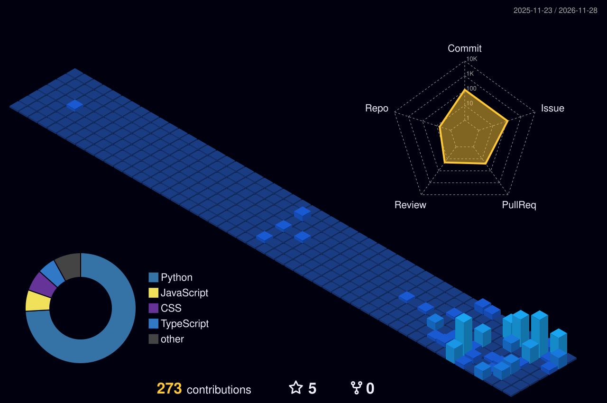
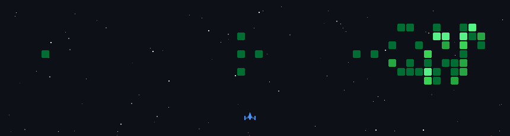

  

<h3 align="center">
 Bryan Moya | Computer Scientist 
</h3>

  

<h2 align="center">Technologies & Tools</h2>

  

<h2 align="center">GitHub Statistics</h2>

  

<h2 align="center">3D Contributions</h2>

  

<h2 align="center">SPACE SHOOTER</h2>

  

 

 

  <strong>Thanks for visiting my profile!</strong>
   
  <code>while (alive) { learn(); build(); }</code>

  
  

  © 2026 Bryan Moya

